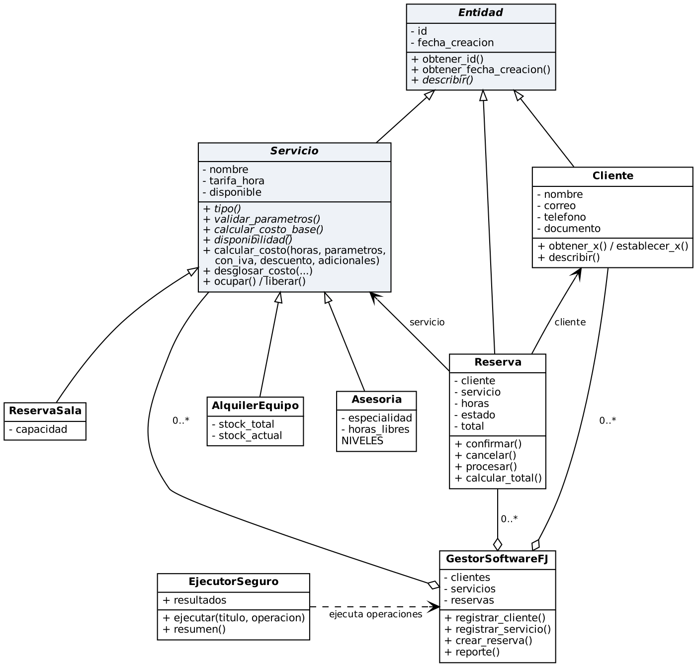
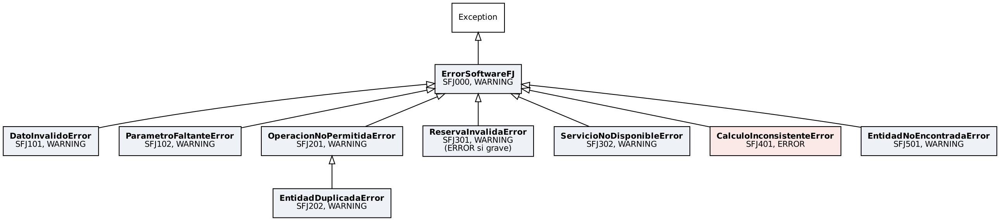

# Software FJ, Fase 4

Sistema orientado a objetos para gestionar clientes, servicios y reservas de la empresa Software FJ, sin base de datos y con manejo avanzado de excepciones.

Trabajo colaborativo del curso Programación (213023) de la Universidad Nacional Abierta y a Distancia UNAD, grupo 213023_285, tutor Fabián Augusto Ávila Orjuela.

## Contenido del repositorio

| Ruta | Descripción |
| --- | --- |
| `Software_FJ_Fase4.ipynb` | Cuaderno de Jupyter con todo el sistema y las simulaciones |
| `software_fj.log` | Log que deja la última ejecución completa del cuaderno |
| `docs/diagrama_clases.png` | Diagrama de clases del dominio y de la aplicación |
| `docs/jerarquia_excepciones.png` | Jerarquía de excepciones personalizadas |

## Cómo ejecutarlo

El proyecto solo usa la biblioteca estándar de Python, así que no hay dependencias que instalar. Se probó con Python 3.13.

1. Clonar el repositorio.

   ```bash
   git clone https://github.com/SecolDevs/programacion-grupo-213023_285.git
   cd programacion-grupo-213023_285
   ```

2. Abrir `Software_FJ_Fase4.ipynb` en Jupyter, VS Code o Google Colab.
3. Ejecutar todas las celdas en orden con Restart and run all.

Cada ejecución crea de nuevo el archivo `software_fj.log` en la misma carpeta del cuaderno.

## Arquitectura



| Clase | Responsabilidad |
| --- | --- |
| `Entidad` | Clase abstracta base con identificador único de solo lectura |
| `Cliente` | Datos personales encapsulados y validados |
| `Servicio` | Clase abstracta con el cálculo de costos y la sobrecarga simulada |
| `ReservaSala`, `AlquilerEquipo`, `Asesoria` | Servicios concretos, cada uno con sus reglas |
| `Reserva` | Une cliente, servicio y duración y controla los estados |
| `GestorSoftwareFJ` | Listas en memoria de clientes, servicios y reservas |
| `EjecutorSeguro` | Corre cada operación sin dejar que un error detenga el programa |

## Manejo de excepciones

Todas las excepciones propias heredan de `ErrorSoftwareFJ`. Cada una tiene un código y un nivel de log.



El cuaderno usa estos mecanismos.

| Mecanismo | Dónde se aplica |
| --- | --- |
| `try/except` | `a_numero` y `exigir_parametro` |
| `try/except/else` | `GestorSoftwareFJ._buscar_por_id` y `leer_ultimas_lineas` |
| `try/finally` | `Reserva.cancelar` |
| `try/except/else/finally` | `Reserva.procesar` y `EjecutorSeguro.ejecutar` |
| `raise ... from` | Conversión de `ValueError`, `KeyError` y `OSError` en excepciones propias |

## Simulaciones

El cuaderno corre 38 operaciones sobre un mismo gestor, unas válidas y otras inválidas, y ninguna detiene la aplicación. Las 38 coinciden con el resultado esperado.

| Grupo | Operaciones | Exitosas | Fallos controlados | Errores imprevistos atrapados |
| --- | --- | --- | --- | --- |
| Clientes | 8 | 3 | 5 | 0 |
| Servicios | 7 | 4 | 3 | 0 |
| Costos y polimorfismo | 4 | 2 | 2 | 0 |
| Reservas | 17 | 4 | 13 | 0 |
| Error imprevisto y reporte | 2 | 1 | 0 | 1 |
| Total | 38 | 14 | 23 | 1 |

El log registra cada operación con fecha, hora, nivel, función y mensaje. INFO guarda lo que salió bien, WARNING los fallos de datos o de reglas y ERROR los fallos graves o imprevistos con su traceback. La última ejecución completa, en Python 3.13, dejó 220 líneas en `software_fj.log`, con 144 INFO, 23 WARNING y 3 ERROR.

## Flujo de trabajo del grupo

Cada integrante trabaja en su propia rama, sube commits descriptivos y abre un pull request enlazado a su issue. Las tareas pendientes están en la pestaña Issues del repositorio.

## Integrantes

| Integrante | Usuario de GitHub | Aporte en el repositorio |
| --- | --- | --- |
| Yordi Sebastián Colón Cárdenas | [SecolDevs](https://github.com/SecolDevs) | Versión inicial del cuaderno, README, guía de colaboración y comentarios del logging y las excepciones (#1, #2, #3) |
| Sara Valerie Ortiz Moreno | [09valeriamoreno09-ops](https://github.com/09valeriamoreno09-ops) | Comentarios de las clases Cliente y Servicio y de los servicios concretos (#4, PR #9) |
| Juan Sebastián Prieto Trujillo | [JuansePrieto](https://github.com/JuansePrieto) | Simulaciones de reservas de asesorías (#5, PR #10) |
| Cristian Andrés Acuña Sequeda | | Plantilla del informe de la Fase 4 |
